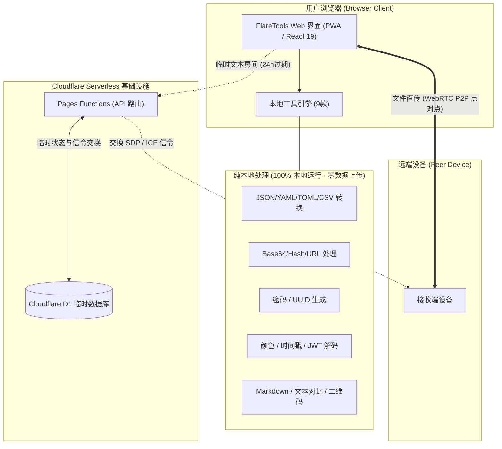

# FlareTools 🛠️

[English](./README_EN.md) | **简体中文**

> **FlareTools** 是一个现代化、注重隐私的轻量级开源开发者工具箱，也是**一方产品**之一，官方线上体验地址为 [一方工具](https://tools.arcinks.com/)。支持双语国际化、浅色/深色/系统自适应模式与 PWA 离线使用。

[](./LICENSE)
[](https://react.dev/)
[](https://tailwindcss.com/)
[](https://pages.cloudflare.com/)

---

## 🌟 在线体验与一键部署

- **官方线上实例**：[一方工具 (https://tools.arcinks.com/)](https://tools.arcinks.com/)
- **Deploy to Cloudflare**：

[](https://dash.cloudflare.com/?to=/:account/pages/new)

---

## ✨ 核心亮点

- **隐私绝对优先**：9 款常规开发工具 100% 在浏览器本地沙箱中计算与格式化，输入内容绝不上传服务器。
- **Serverless 零成本托管**：基于 Cloudflare Pages Functions + D1 数据库构建，免除 VPS、Docker 与独立运维成本，使用 Cloudflare 免费计划即可长期稳定运行。
- **PWA 离线运行**：支持安装到电脑桌面与手机主屏幕，断网状态下 9 款本地工具完全可用。
- **安全可控的跨设备传输**：
  - **文本共享**：采用随机 6 位房间号配对，内容写入 D1 临时表，24 小时后系统物理过期并自动清理。
  - **文件快传**：基于 WebRTC 点对点直连（P2P）传输大文件，服务端仅负责交换信令，文件流不经过也不保存在服务器。

---

## 📐 架构与数据流



---

## 🧰 工具清单

| 类别 | 工具 | 路由 | 数据处理路径 |
| :--- | :--- | :--- | :--- |
| **跨设备传输** | 文本共享 | `/share/text` | Cloudflare Functions + D1，24 小时自动销毁 |
| **跨设备传输** | 文件传输 | `/share/file` | WebRTC P2P 点对点传输，服务端仅交换信令 |
| **综合工作台** | 数据万能工作台 | `/dev/transformer` | 浏览器本地（JSON / YAML / TOML / CSV / XML） |
| **综合工作台** | 字符串全能看板 | `/dev/string` | 浏览器本地（Base64 / URL / Hash / 统计） |
| **综合工作台** | 凭证生成中心 | `/dev/generator` | 浏览器本地（UUID / 高强度随机密码） |
| **独立工具** | 颜色转换器 | `/dev/color` | 浏览器本地（HEX / RGB / HSL 实时转换） |
| **独立工具** | 时间戳转换 | `/dev/timestamp` | 浏览器本地（毫秒/秒级双向转换） |
| **独立工具** | JWT 解码器 | `/security/jwt` | 浏览器本地解析与结构查看（不验签） |
| **独立工具** | Markdown 预览 | `/text/markdown` | 浏览器本地实时渲染与 DOMPurify 净化 |
| **独立工具** | 文本对比 (Diff) | `/text/diff` | 浏览器本地逐行/逐词比对 |
| **独立工具** | 二维码生成器 | `/tools/qrcode` | 浏览器本地即时生成与 SVG/PNG 导出 |

---

## 🚀 自托管与部署指南 (Self-Hosting Guide)

推荐两种部署方式：**网页控制台 Git 自动构建（适合大多数用户）** 与 **Wrangler CLI 命令行部署**。

### 准备条件
- 一个 [Cloudflare](https://dash.cloudflare.com/) 免费账号
- Node.js (v18+) 及 npm（如使用本地 CLI）

---

### 方式 A：通过 Cloudflare Pages 控制台部署（推荐）

#### 步骤 1：Fork 仓库
点击本页面右上角的 **Fork**，将仓库克隆到你的 GitHub 账号下。

#### 步骤 2：创建 D1 数据库并初始化表结构
1. 登录 [Cloudflare 控制台](https://dash.cloudflare.com/)，在左侧导航进入 **Storage & Databases** -> **D1 SQL Database**。
2. 点击 **Create database**，输入数据库名称 `flare-tools-db` 并确认创建。
3. 点击进入刚创建的 `flare-tools-db`，进入 **Console** 标签页。
4. 将本项目根目录的 [`schema.sql`](./schema.sql) 文件内容完整复制到控制台中，点击 **Execute** 执行初始化。

#### 步骤 3：连接 Pages 项目
1. 在控制台左侧进入 **Compute (Workers & Pages)** -> **Create application** -> 选择 **Pages** -> **Connect to Git**。
2. 授权并选择你刚刚 Fork 的 `FlareTools` 仓库。
3. 构建配置：
   - **Framework preset**: `Vite`
   - **Build command**: `npm run build`
   - **Build output directory**: `dist`
4. 点击 **Save and Deploy** 开始初次构建。

#### 步骤 4：绑定 D1 数据库（必须配置）
1. 构建完成后，进入该 Pages 项目的管理页面，点击 **Settings** 标签页。
2. 在左侧选择 **Functions**，向下滚动找到 **D1 database bindings**。
3. 点击 **Add binding**：
   - **Variable name（变量名称）**：填写 `DB`（严格大写）
   - **D1 database**：选择在步骤 2 创建的 `flare-tools-db`
4. 点击 **Save** 保存配置。在 **Deployments** 重新触发一次部署即可全部生效！

---

### 方式 B：通过 Wrangler 命令行快速部署

如果你熟悉命令行，可以通过 Wrangler CLI 一键完成：

```bash
# 1. 克隆代码并安装依赖
git clone https://github.com/arctan303/FlareTools.git
cd FlareTools
npm install

# 2. 登录 Cloudflare
npx wrangler login

# 3. 创建 D1 数据库
npx wrangler d1 create flare-tools-db
# 控制台会输出 database_id，将其填入 wrangler.toml 中的 database_id 字段

# 4. 执行 SQL 初始化
npx wrangler d1 execute flare-tools-db --remote --file=./schema.sql

# 5. 构建并发布
npm run build
npx wrangler pages deploy dist --project-name=flare-tools
```

---

## ⚙️ 环境变量矩阵

FlareTools 针对开源自建做了**弹性容错设计**。如果不配置任何防刷 Key，所有功能依然可以正常使用（非常适合个人或团队内部私有部署）。

参考目录下的 [`.env.example`](./.env.example) 与 [`.dev.vars.example`](./.dev.vars.example)：

| 变量名 | 作用位置 | 类型 | 默认行为 / 说明 |
| :--- | :--- | :--- | :--- |
| `DB` | Cloudflare Pages D1 Binding | 必须 | 绑定的 D1 数据库实例变量名（必须为 `DB`）。 |
| `ENABLE_TURNSTILE` | Pages 环境变量 (Backend) | 可选 | 默认为 `true`。设为 `false` 可彻底关闭文本房间的人机验证。 |
| `TURNSTILE_SECRET_KEY` | Pages 环境变量 (Backend) | 可选 | 未配置时，后端会自动弹性跳过验证码校验。 |
| `VITE_TURNSTILE_SITE_KEY` | 前端构建变量 (Frontend) | 可选 | 前端加载 Turnstile 小部件的 SiteKey。 |
| `ALLOWED_ORIGIN` | Pages 环境变量 (Backend) | 可选 | 允许的 CORS Origin。默认为 `*`，支持透传当前请求 Origin。 |
| `VITE_SITE_URL` | 前端构建变量 (Frontend) | 可选 | 设置 Canonical SEO 基础域名，默认自动读取浏览器 `window.location.origin`。 |

---

## ❓ 常见问题排查 (FAQ)

### Q1: 文本共享创建房间提示 500 服务器错误？
- **原因**：通常是 Pages 项目未绑定 D1 数据库，或未执行数据库初始化 SQL。
- **解决**：
  1. 确认已在 Pages 项目的 **Settings -> Functions -> D1 database bindings** 中添加了名为 `DB` 的绑定。
  2. 确认在 D1 控制台中执行了 [`schema.sql`](./schema.sql)。

### Q2: 文件快传（WebRTC）两台设备无法连接或连接超时？
- **原因**：WebRTC P2P 直连依赖双方设备的网络 NAT 类型。本项目默认使用公共 Google STUN 服务器协助穿透。如果双方均处于企业级对称 NAT（Symmetric NAT）或严格防火墙后，直连可能会受阻。
- **解决**：尝试让其中一台设备连接手机热点或非严格防火墙网络。

### Q3: 文本房间创建提示人机验证失败？
- **原因**：单个 IP 一天免费创建超过 2 个房间时会触发防刷检测。若未配置 Cloudflare Turnstile 密钥则会校验失败。
- **解决**：在 Pages 环境变量中设置 `ENABLE_TURNSTILE=false`，即可在私有部署中无限次免验证创建。

---

## 💻 本地开发与测试

```bash
# 启动前端热重载开发服务器
npm run dev

# 运行代码规范检查
npm run lint

# 运行 40 项单元测试与边界测试
npm test

# 生产环境打包
npm run build
```

---

## 📄 开源协议

本项目基于 [MIT License](./LICENSE) 开源，欢迎提交 Pull Request、报告 Issue 或将其 Fork 作为日常生产力工具！
