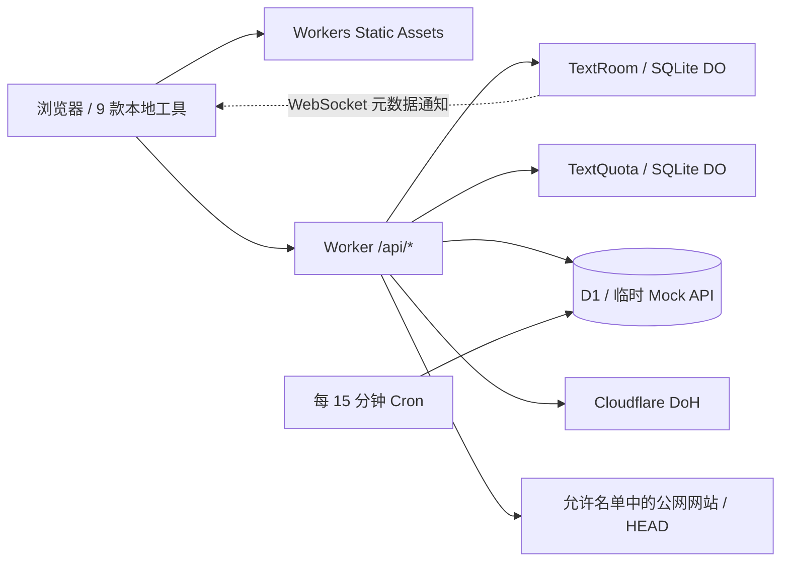

# FlareTools 🛠️

[English](./README_EN.md) | **简体中文**

**FlareTools** 是轻量的开源开发者工具箱，也是一方产品之一。官方站点：[FlareTools](https://tools.arcinks.com/)；源码：[arctan303/FlareTools](https://github.com/arctan303/FlareTools)。

React 19 + Vite + Tailwind CSS 4，支持中英双语、浅色 / 深色 / 系统主题和 PWA。整个项目部署为一个 **Cloudflare Worker**，静态页面、本地工具、文本共享、网络诊断与临时 Mock API 使用同一站点。

[](./LICENSE)
[](https://developers.cloudflare.com/workers/)

## 工具清单

共 12 款工具，其中 9 款在浏览器本地处理输入。已加载并缓存的本地工具可离线使用，云端工具需要联网。

| 工具 | 路由 | 处理方式 |
| --- | --- | --- |
| 数据万能工作台 | `/dev/transformer` | 本地：JSON / YAML / TOML / CSV 转换，JavaScript / HTML / CSS / SQL 格式化 |
| 字符串全能看板 | `/dev/string` | 本地：Base64 / URL 编解码、Hash、统计 |
| 凭证生成中心 | `/dev/generator` | 本地：随机密码、UUID |
| 颜色转换器 | `/dev/color` | 本地：HEX / RGB / HSL |
| 时间戳转换 | `/dev/timestamp` | 本地：秒 / 毫秒、UTC / 本地显示 |
| JWT 解码器 | `/security/jwt` | 本地：查看头部与载荷，不验证签名 |
| Markdown 预览 | `/text/markdown` | 本地：渲染与 DOMPurify 净化 |
| 文本对比 | `/text/diff` | 本地：逐行 / 逐词 / 逐字符对比 |
| 二维码生成器 | `/tools/qrcode` | 本地：PNG / SVG 导出 |
| 文本共享 | `/share/text` | Workers + SQLite Durable Objects + WebSocket |
| 网络诊断 | `/dev/network-inspector` | Workers：公网 IP / ASN、DNS、HTTP 响应头与跳转 |
| JSON Mock API | `/dev/mock-api` | Workers + D1：临时公开 JSON 接口 |

## 架构与免费计划



[`wrangler.toml`](./wrangler.toml) 是部署配置。`ASSETS` 提供 `dist`，启用 SPA 回退；`/api` 与 `/api/*` 始终先交给 Worker，未知 API 返回 JSON 404。两个 SQLite DO 类 `TextRoom`、`TextQuota` 随同一个 Worker 部署，首次发布时由 migration 创建，无需单独发布其他 Worker。

静态资源直接由 Static Assets 提供，不消耗 Worker 请求额度。API 调用、DO 请求与运行时间、DO / D1 存储和数据库读写仍受免费计划限制。项目通过取消正常房间轮询、WebSocket Hibernation、输入上限和创建配额控制用量，不承诺无限免费运行。额度和计费以官方 [Static Assets](https://developers.cloudflare.com/workers/static-assets/billing-and-limitations/)、[Workers](https://developers.cloudflare.com/workers/platform/pricing/)、[Durable Objects](https://developers.cloudflare.com/durable-objects/platform/pricing/)、[D1](https://developers.cloudflare.com/d1/platform/pricing/) 文档为准。

## 云端工具的行为

**文本共享**

- 随机 6 位房间号，每房间最多 10 名成员，正文最多 10,000 字符。停止输入 1.5 秒后自动保存。
- 有效期固定为创建后 24 小时，读取、加入与保存均不会续期。过期后立即拒绝访问，DO Alarm 负责物理清理；成员也可提前销毁房间。
- WebSocket 只推送版本与成员元数据。健康连接不轮询，正文在加入或主动拉取时通过 HTTP 返回。断线会退避重连。
- 保存携带版本号，并发修改产生冲突时由用户选择拉取远端或保留自己的修改，避免静默覆盖。
- 每 IP 每个 UTC 日最多创建 20 个房间。启用并正确配置 Turnstile 后，前 2 个无需验证码，之后需要验证；未配置密钥或关闭验证时仍保留每天 20 个的上限。
- 文本会存储在服务端，**尚未实现端到端加密**。知道房间号的人可以加入房间并读取内容，请仅向需要共享的设备提供房间号。

**网络诊断**

显示 Cloudflare 看到的公网 IP、ASN、网络组织、国家代码与机房；使用 Cloudflare DoH 查询 A / AAAA / CNAME / MX / TXT / NS。HTTP 检查只发送 HEAD，返回状态与响应头，最多跟随 5 次跳转；耗时反映 Cloudflare 边缘到目标网站的连接。域名与网址会发送给 Cloudflare，本工具不保存结果。

HTTP 仅检查下列精确域名，跳转目标也必须在允许名单中：`tools.arcinks.com`、`example.com`、`cloudflare.com`、`www.cloudflare.com`、`developers.cloudflare.com`、`github.com`、`www.wikipedia.org`。可通过 `NETWORK_ALLOWED_HOSTS` 添加可信公网域名。该限制配合逐跳 DNS 验证、私有 / 保留 IP 拦截、超时及大小限制，避免开放任意代理。部分站点不支持 HEAD，其返回的错误状态会如实显示。

**JSON Mock API**

发布最大 32 KiB 的 JSON，选择状态码与 1 / 6 / 24 小时有效期，每 IP 每个 UTC 日最多创建 20 个。公开地址支持 GET / HEAD，任何拿到链接的人都可读取，**不要发布私密数据**。管理令牌只在创建时交给用户，服务端仅保存其 Hash；删除接口需要该令牌。

D1 的 `rooms_kv` 保存 Mock 数据与创建配额，索引覆盖过期时间。读取立即排除已过期数据；每 15 分钟 Cron 最多清理 1,000 条最早过期记录，积压时分批处理。

## 本地运行

使用 **Node.js 24** 与 npm，测试使用 Node 内置的 `node:sqlite`。先克隆与安装：

```bash
git clone https://github.com/arctan303/FlareTools.git
cd FlareTools
npm install
```

运行包含前端、API、DO 和本地 D1 的完整站点：

```bash
npm run build
npm run db:local
npm run dev:worker
```

本地 Worker 监听 `http://127.0.0.1:8787`。启动命令显式设置本地 upstream，避免生产自定义域名配置把 Mock 链接改成线上地址；修改端口时，请同时修改 `--port`、`--local-upstream` 和 Vite 代理。

打开 Wrangler 显示的地址，通常是 `http://127.0.0.1:8787`。本地数据库与 DO 状态由 Wrangler 保存在 `.wrangler`，与远端数据独立；本地公网 IP / ASN / 国家等信息可能为空。

需要前端热重载时保留上述 Worker 终端，再开第二个终端执行 `npm run dev`，打开 Vite 显示的地址。Vite 已将 `/api` 的 HTTP 和 WebSocket 请求代理至 8787，并重写开发 Origin。只运行 Vite 时，云端工具不可用。

可选：将 [`.env.example`](./.env.example) 复制为 `.env`，将 [`.dev.vars.example`](./.dev.vars.example) 复制为 `.dev.vars`，填写所需配置。修改配置后重启对应服务，前端变量修改后重新构建。

## 部署到 Cloudflare Workers

准备 Cloudflare 账号并安装依赖。自建时先将 [`wrangler.toml.example`](./wrangler.toml.example) 复制为 `wrangler.toml`，修改 `name` 为自己的 Worker 名称；创建数据库后填入自己的 `database_id`。如配置 `routes`，只能填写自己 Cloudflare 账号中的域名。不要直接使用仓库中的官方数据库 ID 或官方域名配置。随后按顺序执行：

```bash
npm test
npm run lint
npm run build
npx wrangler login
npx wrangler d1 create flare-tools-db
```

把创建结果中的 `database_id` 填入 [`wrangler.toml`](./wrangler.toml) 的 `[[d1_databases]]`，保持绑定名 `DB`。随后执行：

```bash
npm run db:remote
npm run check:worker
npm run deploy
```

`schema.sql` 仅使用 `CREATE TABLE IF NOT EXISTS` 与 `CREATE INDEX IF NOT EXISTS`，初始化不会删除已有表。`check:worker` 打包并执行部署 dry run，不发布；`deploy` 重新构建并发布 Worker 与静态资源。配置中的 DO migrations、两个 DO bindings 和 Cron 随部署生效。D1 服务于 Mock API，文本共享使用 DO。

官方 Worker 名称为 `flaretools`，官方站点为 `https://tools.arcinks.com`，Worker 默认入口 `https://flaretools.arctan.workers.dev` 也保持启用。自建实例请使用自己的 workers.dev 地址或通过 `routes` 绑定自己的域名，并配置相应的 Turnstile 域名。

构建会为现有首页、关于和12个工具路由生成独立静态HTML，包含对应标题、简介、canonical及无JavaScript说明；交互和语言切换仍由原React客户端处理。构建在PWA预缓存前完成，不改变API路由或分享内容的访问权限。`robots.txt` 声明允许搜索和AI输入、禁止训练，并保留 `/api/` 抓取限制；内容信号不代替鉴权。

自定义域名时，构建前设置 `VITE_SITE_URL`；生成页面的canonical、Open Graph URL与WebSite JSON-LD会使用该域名。仍需手动更新 [`public/sitemap.xml`](./public/sitemap.xml)、[`public/robots.txt`](./public/robots.txt) 中的站点地址；开发用的 [`index.html`](./index.html) 保留通用占位内容。

本版本不导入旧部署的临时文本房间。切换实例前可手动复制仍需保留的文本，原实例中的房间按原有效期到期。

## GitHub 推送自动部署

官方 `flaretools` Worker 已通过 Cloudflare 原生 **Workers Builds** 连接 [arctan303/FlareTools](https://github.com/arctan303/FlareTools)，生产分支为 `main`。`main` 的新推送会触发构建与部署，不需要额外的 GitHub Actions 配置。

自建实例可在 Cloudflare 的 **Workers & Pages → 对应 Worker → Settings → Builds** 中点击 **Connect**，选择 GitHub 仓库，并配置：

| 设置 | 官方实例的值 / 自建参考 |
| --- | --- |
| GitHub 仓库 | `arctan303/FlareTools`；自建选择自己的 Fork |
| 生产分支 | `main` |
| Root directory | `/` |
| Build command | `npm run lint && npm test && npm run build` |
| Deploy command | `npx wrangler deploy` |
| 构建变量 `NODE_VERSION` | `24` |
| 构建变量 `VITE_SITE_URL` | `https://tools.arcinks.com`；自建填写自己的站点地址 |
| Build cache | 开启 |
| 非生产分支 / Preview builds | 关闭，仅部署生产分支 |
| 构建 API 令牌 | 官方复用已有 Workers 构建令牌；自建选择自己账号中具有部署权限的令牌 |

GitHub App 需要有目标仓库的读取权限；已有授权可直接使用。后端密钥继续保存在 Worker secrets，前端公开 Site Key 如需启用 Turnstile，在构建变量中设置。

**首次推送必须包含当前 Worker 源码与配置**：`worker/`、前端代码、`package.json` / `package-lock.json`、`wrangler.toml` 及相关构建文件。官方配置中的 `name` 必须为 `flaretools`，这样原生 Builds 才会部署到现有 Worker；自建配置必须与自己的 Worker 名称一致，并使用自己的 D1 ID 与域名。不要提交 `.env`、`.dev.vars`、Turnstile secret 或 API 令牌。

仓库提交后在 **Builds** 查看该次提交的构建与部署日志。连接仓库本身不会把尚未提交的本地源码同步到 GitHub；下一次 `main` 推送需要包含上述改动。更多配置参见 [Workers Builds 官方文档](https://developers.cloudflare.com/workers/ci-cd/builds/)。

## 配置说明

| 配置 | 位置 | 行为 |
| --- | --- | --- |
| `ASSETS` | `wrangler.toml` 的 assets binding | 提供构建后的静态站点 |
| `TEXT_ROOMS` / `TEXT_QUOTAS` | `wrangler.toml` 的 DO bindings | 绑定 `TextRoom` / `TextQuota`，均采用 SQLite |
| `DB` | `wrangler.toml` 的 D1 binding | Mock API 数据库；填入自己的 `database_id` |
| `TURNSTILE_SECRET_KEY` | Workers secret；本地 `.dev.vars` | 可选后端密钥，不得放入 `VITE_*` 变量 |
| `ENABLE_TURNSTILE` | Workers `[vars]`；本地 `.dev.vars` | 配置密钥时默认启用；设为字符串 `false` 可关闭验证，硬配额仍生效 |
| `VITE_TURNSTILE_SITE_KEY` | 构建时 `.env` 或构建环境 | 可选前端公开 Site Key，启用验证时需与后端密钥配套 |
| `VITE_SITE_URL` | 构建时 `.env` 或构建环境 | SEO canonical 基础域名，官方实例使用 `https://tools.arcinks.com`；自建需改为自己的地址 |
| `NETWORK_ALLOWED_HOSTS` | Workers `[vars]`；本地 `.dev.vars` | 逗号分隔的额外可信精确域名，保留默认名单；不接受 URL 或通配符 |
| `ALLOWED_ORIGIN` | Workers `[vars]`；本地 `.dev.vars` | 可选文本共享额外允许的精确 Origin，默认同源；不是全站 CORS 开关，不使用 `*` |

生产配置示例，在 `wrangler.toml` 增加：

```toml
[vars]
ENABLE_TURNSTILE = "true"
NETWORK_ALLOWED_HOSTS = "your-domain.com,status.your-domain.com"
```

后端密钥通过 `npx wrangler secret put TURNSTILE_SECRET_KEY` 设置；前端 Site Key 在构建前设置。`.dev.vars` 只供本地使用，不会自动成为生产配置。`.env` 与 `.dev.vars` 已被 Git 忽略。

## 验证与排查

| 命令 | 用途 |
| --- | --- |
| `npm test` | 单元测试、真实 SQLite API / 路由 / 过期清理测试 |
| `npm run lint` | 前端与 Worker 代码规范检查 |
| `npm run build` | 生成前端与 PWA 资源 |
| `npm run check:worker` | 检查 Worker 打包与配置，不部署 |
| `npm run test:worker` | 启动本地 Worker 后，验证真实 DO / WebSocket / D1 与路由 |

线上烟测用 `WORKER_TEST_URL` 指定站点。官方自定义域名的 WAF 会阻断未知 API，测试时设置 `WORKER_TEST_WAF_BLOCKS_UNKNOWN_API=true`，检查 Cloudflare 的 403 拦截页；默认不设置时检查 Worker 的 JSON 404。已使用的 API 仍需正常通过全部测试。

`test:worker` 正常运行会创建 1 个文本房间和 1 个 Mock API，完成后清理测试数据，但仍会消耗正常的每日创建配额。脚本不提交 Turnstile 验证码；同一 IP 的创建次数进入验证码验证阶段后，烟测会因 `CAPTCHA_REQUIRED` 失败。请在有足够创建配额、且本次创建无需验证码的环境中运行。

- 文本共享提示服务不可用：检查两个 DO bindings、SQLite migration 及部署是否完成，不需要为文本共享初始化 D1。
- Mock API 提示存储不可用：检查 `DB` 与 `database_id`，执行相应环境的 `db:local` 或 `db:remote`。
- 创建房间要求验证码：配置成对的 Turnstile Site Key / Secret Key，并将当前域名加入 Turnstile 配置；关闭验证码不会取消每日硬配额。
- 文本未同步到编辑区：通知只提示版本改变，需要主动拉取；有并发冲突时先选择如何保留修改。
- HTTP 域名被拒绝：选择界面列出的站点，或由部署者通过 `NETWORK_ALLOWED_HOSTS` 添加可信精确域名。
- 自定义域名 API 返回 Cloudflare HTML 403 拦截页：检查该域名所在 zone 的 WAF，确保规则覆盖本站实际使用的 `/api/text-share/*`、`/api/network` 与 `/api/mock/*` 路径。只允许旧文本共享路径的规则可能会拦截新增工具；Cloudflare 的 HTML 拦截页不是应用返回的 JSON 错误。

## 开源协议

[MIT License](./LICENSE)。欢迎通过 [GitHub](https://github.com/arctan303/FlareTools) 提交 Issue 或 Pull Request。
