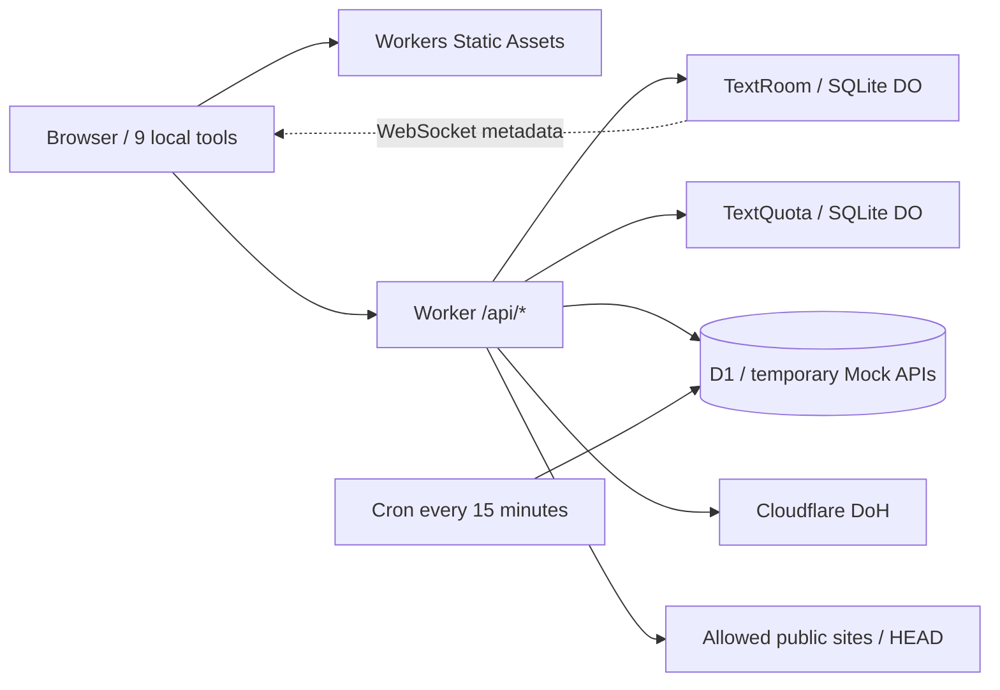

# FlareTools 🛠️

**English** | [简体中文](./README.md)

**FlareTools** is a lightweight open-source developer toolbox and one of Arc's first-party products. Official site: [FlareTools](https://tools.arcinks.com/). Source: [arctan303/FlareTools](https://github.com/arctan303/FlareTools).

Built with React 19, Vite, and Tailwind CSS 4, with Chinese / English, light / dark / system themes, and PWA support. The entire project deploys as **one Cloudflare Worker**, serving the static site, local utilities, text sharing, network diagnostics, and temporary Mock APIs on the same origin.

[](./LICENSE)
[](https://developers.cloudflare.com/workers/)

## Tools

There are 12 tools, including 9 that process inputs locally in the browser. Loaded and cached local tools can work offline; cloud tools require a connection.

| Tool | Route | Processing |
| --- | --- | --- |
| Data Transformer | `/dev/transformer` | Local: JSON / YAML / TOML / CSV conversion; JavaScript / HTML / CSS / SQL formatting |
| String Processor | `/dev/string` | Local: Base64 / URL encoding and decoding, hashes, statistics |
| Generator Hub | `/dev/generator` | Local: random passwords, UUIDs |
| Color Converter | `/dev/color` | Local: HEX / RGB / HSL |
| Timestamp Converter | `/dev/timestamp` | Local: seconds / milliseconds, UTC / local display |
| JWT Decoder | `/security/jwt` | Local: headers and payload; no signature verification |
| Markdown Preview | `/text/markdown` | Local: rendering and DOMPurify sanitization |
| Text Diff | `/text/diff` | Local: line / word / character comparison |
| QR Code Generator | `/tools/qrcode` | Local: PNG / SVG export |
| Text Share | `/share/text` | Workers + SQLite Durable Objects + WebSocket |
| Network Inspector | `/dev/network-inspector` | Workers: public IP / ASN, DNS, HTTP headers and redirects |
| JSON Mock API | `/dev/mock-api` | Workers + D1: temporary public JSON endpoints |

## Architecture and the free plan



[`wrangler.toml`](./wrangler.toml) is the deployment configuration. `ASSETS` serves `dist` with SPA fallback; `/api` and `/api/*` always invoke the Worker first, and unknown APIs return JSON 404. The SQLite DO classes `TextRoom` and `TextQuota` deploy with this same Worker. Their migration creates the classes on first deployment; no separate Worker deployment is needed.

Requests served directly by Static Assets do not consume Worker request quota. API calls, DO requests and duration, DO / D1 storage, and database reads and writes remain subject to free-plan limits. Normal rooms avoid polling and use WebSocket Hibernation; payload limits and creation quotas reduce usage. This is not a promise of unlimited free hosting. Consult the current official [Static Assets](https://developers.cloudflare.com/workers/static-assets/billing-and-limitations/), [Workers](https://developers.cloudflare.com/workers/platform/pricing/), [Durable Objects](https://developers.cloudflare.com/durable-objects/platform/pricing/), and [D1](https://developers.cloudflare.com/d1/platform/pricing/) documentation.

## Cloud tool behavior

**Text Share**

- Random six-digit room codes, up to 10 members per room, and up to 10,000 characters of text. Changes save after 1.5 seconds without typing.
- Expiry is fixed at 24 hours after creation. Reads, joins, and saves do not extend it. Expired rooms immediately reject access; a DO Alarm handles physical cleanup. Members can also destroy a room early.
- WebSockets carry version and membership metadata only. Healthy connections do not poll. The HTTP API returns text when joining or explicitly pulling it; disconnected clients reconnect with backoff.
- Saves include a revision number. Concurrent edits trigger a conflict so the user can pull the remote version or keep their edits instead of silently overwriting another device.
- Each IP can create at most 20 rooms per UTC day. When Turnstile is enabled and configured, the first two need no captcha and later creations require verification. Missing keys or disabled verification do not remove the daily cap.
- Text is stored on the server; **end-to-end encryption is not implemented**. Anyone who knows the room code can join and read its contents. Share the code only with intended devices.

**Network Inspector**

Shows the public IP, ASN, network organization, country code, and location seen by Cloudflare. DNS queries use Cloudflare DoH for A / AAAA / CNAME / MX / TXT / NS. HTTP checks send HEAD, return status and response headers, and follow up to five redirects. Timing measures the Cloudflare edge-to-site connection. Domains and URLs are sent to Cloudflare; the tool does not store its results.

HTTP checks support these exact domains, including redirect destinations: `tools.arcinks.com`, `example.com`, `cloudflare.com`, `www.cloudflare.com`, `developers.cloudflare.com`, `github.com`, and `www.wikipedia.org`. Operators can add trusted public hosts with `NETWORK_ALLOWED_HOSTS`. This restriction, DNS checks for each hop, private / reserved IP rejection, timeouts, and size limits keep the endpoint from becoming an arbitrary proxy. Some sites reject HEAD; their returned error status is still displayed.

**JSON Mock API**

Publish up to 32 KiB of JSON with a chosen response status and a lifetime of 1 / 6 / 24 hours. Each IP can create at most 20 per UTC day. Public URLs support GET / HEAD and can be read by anyone with the link: **do not publish private data**. The management token is returned only on creation, and the server stores its hash. Deletion requires that token.

D1's `rooms_kv` table stores Mock data and creation quotas, with an expiry index. Reads immediately exclude expired records. A Cron runs every 15 minutes and deletes up to 1,000 of the oldest expired records per run; larger backlogs take multiple batches.

## Run locally

Use **Node.js 24** and npm. Tests use Node's built-in `node:sqlite`. Clone and install:

```bash
git clone https://github.com/arctan303/FlareTools.git
cd FlareTools
npm install
```

Run the complete site, including frontend, APIs, DOs, and local D1:

```bash
npm run build
npm run db:local
npm run dev:worker
```

The local Worker listens at `http://127.0.0.1:8787`. The command explicitly sets a local upstream so production custom-domain routes do not rewrite Mock links to the live site. When changing the port, update `--port`, `--local-upstream`, and the Vite proxy together.

Open the URL printed by Wrangler, usually `http://127.0.0.1:8787`. Wrangler keeps local D1 and DO state in `.wrangler`, independently of remote data. Public IP / ASN / country metadata may be unavailable locally.

For frontend hot reload, leave the Worker running and open a second terminal with `npm run dev`. Open the URL printed by Vite. The Vite proxy forwards `/api` HTTP and WebSocket traffic to port 8787 and rewrites the development Origin. Running Vite alone does not provide the cloud tools.

Optionally copy [`.env.example`](./.env.example) to `.env` and [`.dev.vars.example`](./.dev.vars.example) to `.dev.vars`, then fill in the settings you need. Restart the relevant service after changing configuration; rebuild after changing frontend variables.

## Deploy to Cloudflare Workers

Create a Cloudflare account and install dependencies. For self-hosting, first copy [`wrangler.toml.example`](./wrangler.toml.example) to `wrangler.toml` and set `name` to your own Worker name. Fill in your own `database_id` after creating D1. If configuring `routes`, use a domain in your own Cloudflare account. Do not reuse the official database ID or domain settings from the repository. Then run:

```bash
npm test
npm run lint
npm run build
npx wrangler login
npx wrangler d1 create flare-tools-db
```

Copy the returned `database_id` into `[[d1_databases]]` in [`wrangler.toml`](./wrangler.toml), keeping the binding name `DB`. Then run:

```bash
npm run db:remote
npm run check:worker
npm run deploy
```

`schema.sql` uses only `CREATE TABLE IF NOT EXISTS` and `CREATE INDEX IF NOT EXISTS`, so initialization does not delete existing tables. `check:worker` bundles and performs a deployment dry run without publishing. `deploy` rebuilds and publishes the Worker and static assets. The DO migrations, both DO bindings, and Cron are deployed with the project. D1 is for Mock APIs; text sharing uses DOs.

The official Worker is named `flaretools`. Its official site is `https://tools.arcinks.com`, and its default Worker entry at `https://flaretools.arctan.workers.dev` remains enabled. Self-hosted instances should use their own workers.dev address or configure `routes` for their own domain, and allow the corresponding hostname in Turnstile.

For a custom domain, set `VITE_SITE_URL` before building and manually update the site URLs in [`public/sitemap.xml`](./public/sitemap.xml), [`public/robots.txt`](./public/robots.txt), and the WebSite JSON-LD `url` in [`index.html`](./index.html). `VITE_SITE_URL` affects SEO / page links; it does not rewrite that static content.

This version does not import temporary text rooms from an older deployment. Copy any text you still need before switching instances; rooms on the old instance expire under their original policy.

## Automatic deployment from GitHub

The official `flaretools` Worker is connected to [arctan303/FlareTools](https://github.com/arctan303/FlareTools) through Cloudflare's native **Workers Builds**, with `main` as the production branch. New pushes to `main` trigger a build and deployment without an additional GitHub Actions workflow.

For self-hosting, go to **Workers & Pages → your Worker → Settings → Builds**, select **Connect**, choose your GitHub repository, and configure:

| Setting | Official instance / self-hosting reference |
| --- | --- |
| GitHub repository | `arctan303/FlareTools`; use your own fork for self-hosting |
| Production branch | `main` |
| Root directory | `/` |
| Build command | `npm run lint && npm test && npm run build` |
| Deploy command | `npx wrangler deploy` |
| Build variable `NODE_VERSION` | `24` |
| Build variable `VITE_SITE_URL` | `https://tools.arcinks.com`; use your own site URL for self-hosting |
| Build cache | Enabled |
| Non-production branch / preview builds | Disabled; deploy the production branch only |
| Build API token | The official instance reuses an existing Workers build token; select a token with deployment permissions in your own account for self-hosting |

The GitHub App needs read access to the target repository; an existing authorization can be reused. Backend secrets remain in Worker secrets. If using Turnstile, set its public frontend Site Key as a build variable.

**The first push must include the current Worker source and configuration**: `worker/`, frontend code, `package.json` / `package-lock.json`, `wrangler.toml`, and the relevant build files. The official configuration must keep `name = "flaretools"` so Builds deploys to the existing Worker. A self-hosted configuration must match its own Worker name and use its own D1 ID and domain. Do not commit `.env`, `.dev.vars`, the Turnstile secret, or API tokens.

After pushing, check **Builds** for the commit's build and deployment logs. Connecting the repository does not upload uncommitted local source to GitHub; the next `main` push needs to include these changes. See the [official Workers Builds documentation](https://developers.cloudflare.com/workers/ci-cd/builds/) for more configuration details.

## Configuration

| Setting | Location | Behavior |
| --- | --- | --- |
| `ASSETS` | assets binding in `wrangler.toml` | Serves the built static site |
| `TEXT_ROOMS` / `TEXT_QUOTAS` | DO bindings in `wrangler.toml` | Bind the SQLite classes `TextRoom` / `TextQuota` |
| `DB` | D1 binding in `wrangler.toml` | Mock API database; fill in your own `database_id` |
| `TURNSTILE_SECRET_KEY` | Workers secret; local `.dev.vars` | Optional backend secret; never put it in a `VITE_*` variable |
| `ENABLE_TURNSTILE` | Workers `[vars]`; local `.dev.vars` | Enabled by default when the secret is set; string `false` disables verification but preserves the hard quota |
| `VITE_TURNSTILE_SITE_KEY` | Build-time `.env` or build environment | Optional public site key; pair it with the backend secret when enabling verification |
| `VITE_SITE_URL` | Build-time `.env` or build environment | SEO canonical base URL; the official instance uses `https://tools.arcinks.com`; self-hosted instances should set their own URL |
| `NETWORK_ALLOWED_HOSTS` | Workers `[vars]`; local `.dev.vars` | Comma-separated additional trusted exact hostnames; keeps defaults and rejects URLs / wildcards |
| `ALLOWED_ORIGIN` | Workers `[vars]`; local `.dev.vars` | Optional additional exact origin for text sharing; defaults to same origin, is not a site-wide CORS switch, and does not use `*` |

Example production settings to add to `wrangler.toml`:

```toml
[vars]
ENABLE_TURNSTILE = "true"
NETWORK_ALLOWED_HOSTS = "your-domain.com,status.your-domain.com"
```

Set the backend secret with `npx wrangler secret put TURNSTILE_SECRET_KEY`, and set the frontend Site Key before building. `.dev.vars` is local only and does not automatically become production configuration. `.env` and `.dev.vars` are ignored by Git.

## Checks and troubleshooting

| Command | Purpose |
| --- | --- |
| `npm test` | Unit tests and real SQLite API / routing / expiry cleanup tests |
| `npm run lint` | Frontend and Worker linting |
| `npm run build` | Build the frontend and PWA assets |
| `npm run check:worker` | Check Worker bundling and configuration without deploying |
| `npm run test:worker` | With the local Worker running, verify real DO / WebSocket / D1 and routing |

Set `WORKER_TEST_URL` to smoke-test a live site. The official custom domain's WAF blocks unknown API paths, so set `WORKER_TEST_WAF_BLOCKS_UNKNOWN_API=true` to verify Cloudflare's 403 block page; without this setting, the test requires the Worker's JSON 404. All supported APIs must still pass the full test.

A normal `test:worker` run creates one text room and one Mock API, then cleans up the test data; these creations still consume the normal daily quotas. The script does not submit a Turnstile captcha token, so it fails with `CAPTCHA_REQUIRED` once the IP's creation count requires verification. Run it in an environment with sufficient creation quota where this creation does not require captcha.

- Text Share reports unavailable: check both DO bindings, the SQLite migration, and deployment completion. Text sharing does not require D1 initialization.
- Mock API reports unavailable storage: check `DB` and `database_id`, then run `db:local` or `db:remote` for the correct environment.
- Room creation asks for captcha: configure matching Turnstile Site / Secret Keys and allow the current hostname in Turnstile. Disabling captcha does not remove the hard daily cap.
- Text does not update in the editor: notifications indicate a new version; pull it explicitly. Resolve concurrent-edit conflicts before continuing.
- An HTTP hostname is rejected: choose a site listed in the UI, or ask the operator to add a trusted exact hostname through `NETWORK_ALLOWED_HOSTS`.
- An API on a custom domain returns a Cloudflare HTML 403 block page: check the domain's zone WAF and ensure its rules cover the API paths this site uses: `/api/text-share/*`, `/api/network`, and `/api/mock/*`. A rule that only allows the older text-sharing paths can block the new tools. Cloudflare's HTML block page is not an application JSON error.

## License

[MIT License](./LICENSE). Issues and pull requests are welcome on [GitHub](https://github.com/arctan303/FlareTools).
