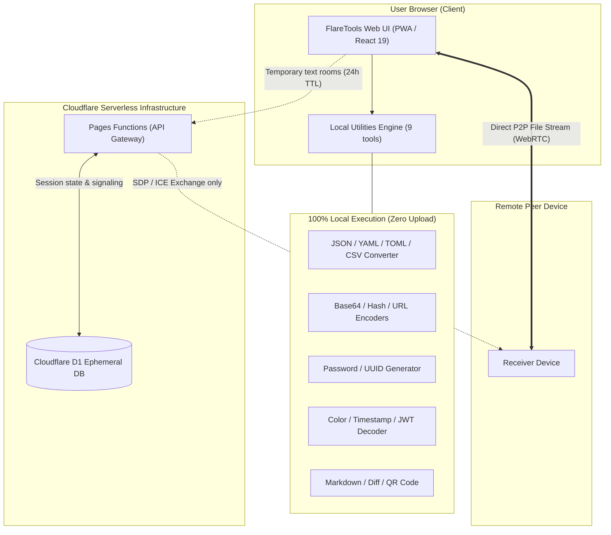

# FlareTools 🛠️

**English** | [简体中文](./README.md)

> **FlareTools** is a modern, privacy-first, lightweight open-source developer toolbox, and an open-source edition of one of Arc's first-party products, officially hosted at [Arc Tools (一方工具)](https://tools.arcinks.com/). Built with React 19, Tailwind CSS 4, and Cloudflare Pages Functions + D1. Supports bilingual i18n, dark/light/system theme adaptation, and PWA offline capability.

[](./LICENSE)
[](https://react.dev/)
[](https://tailwindcss.com/)
[](https://pages.cloudflare.com/)

---

## 🌟 Live Demo & One-Click Deploy

- **Official Live Demo**: [Arc Tools (https://tools.arcinks.com/)](https://tools.arcinks.com/)
- **Deploy to Cloudflare**:

[](https://dash.cloudflare.com/?to=/:account/pages/new)

---

## ✨ Key Highlights

- **Privacy First**: 9 common utility tools execute 100% locally within your browser sandbox. Your input, tokens, and data are NEVER uploaded to any backend.
- **Serverless & $0 Maintenance**: Powered by Cloudflare Pages Functions + Cloudflare D1. No VPS, no Docker daemon, and zero hosting costs under Cloudflare's generous free tier.
- **PWA Offline Ready**: Installable to desktop or mobile home screens; the 9 local tools operate seamlessly even when offline.
- **Ephemeral & Secure Cross-Device Sharing**:
  - **Text Share**: Pair devices via temporary 6-digit room codes. Content stored in D1 auto-expires and physically cleans up after 24 hours.
  - **File Transfer**: Direct WebRTC P2P transmission between peers. The backend only handles transient signaling; files never touch the server.

---

## 📐 Architecture & Data Flow



---

## 🧰 Tools Catalog

| Category | Tool | Route | Data Flow |
| :--- | :--- | :--- | :--- |
| **Cross-Device** | Text Share | `/share/text` | Cloudflare Functions + D1 (24h auto-expiry) |
| **Cross-Device** | File Transfer | `/share/file` | WebRTC P2P direct transmission (signaling only) |
| **Workspace** | Data Transformer | `/dev/transformer` | Local browser (JSON / YAML / TOML / CSV / XML) |
| **Workspace** | String Processor | `/dev/string` | Local browser (Base64 / URL / Hash / Stats) |
| **Workspace** | Generator Hub | `/dev/generator` | Local browser (UUID / High-entropy Password) |
| **Focused** | Color Converter | `/dev/color` | Local browser (HEX / RGB / HSL bidirectional) |
| **Focused** | Timestamp Converter | `/dev/timestamp` | Local browser (Millisecond / Second conversion) |
| **Focused** | JWT Decoder | `/security/jwt` | Local browser (Inspect payload/headers, no sign check) |
| **Focused** | Markdown Preview | `/text/markdown` | Local browser (Live preview with DOMPurify sanitize) |
| **Focused** | Text Diff | `/text/diff` | Local browser (Side-by-side & unified diffing) |
| **Focused** | QR Code Generator | `/tools/qrcode` | Local browser (SVG & PNG instant export) |

---

## 🚀 Self-Hosting Guide

We recommend two deployment methods: **Cloudflare Pages Dashboard (Recommended for most users)** and **Wrangler CLI**.

### Prerequisites
- A free [Cloudflare Account](https://dash.cloudflare.com/)
- Node.js (v18+) and npm (if using the CLI)

---

### Option A: Deploy via Cloudflare Dashboard (Recommended)

#### Step 1: Fork the Repository
Click the **Fork** button at the top right of this repository to create a copy in your GitHub account.

#### Step 2: Create D1 Database and Execute Schema
1. Go to [Cloudflare Dashboard](https://dash.cloudflare.com/) -> Navigate to **Storage & Databases** -> **D1 SQL Database**.
2. Click **Create database**, name it `flare-tools-db`, and confirm.
3. Open `flare-tools-db` and select the **Console** tab.
4. Copy the entire contents of [`schema.sql`](./schema.sql) from this repository, paste it into the console, and click **Execute**.

#### Step 3: Connect to Cloudflare Pages
1. In the Cloudflare Dashboard, go to **Compute (Workers & Pages)** -> **Create application** -> **Pages** -> **Connect to Git**.
2. Select your forked `FlareTools` repository.
3. Set build configuration:
   - **Framework preset**: `Vite`
   - **Build command**: `npm run build`
   - **Build output directory**: `dist`
4. Click **Save and Deploy**.

#### Step 4: Bind D1 Database (Critical Step)
1. Once deployed, open your Pages project -> Go to the **Settings** tab.
2. In the left menu, select **Functions**, then scroll down to **D1 database bindings**.
3. Click **Add binding**:
   - **Variable name**: `DB` *(Must be exactly uppercase `DB`)*
   - **D1 database**: Select `flare-tools-db`
4. Click **Save**. Trigger a redeployment under **Deployments** for the binding to take effect.

---

### Option B: Deploy via Wrangler CLI

If you prefer the terminal:

```bash
# 1. Clone repo and install dependencies
git clone https://github.com/arctan303/FlareTools.git
cd FlareTools
npm install

# 2. Login to Cloudflare
npx wrangler login

# 3. Create D1 database
npx wrangler d1 create flare-tools-db
# Copy the generated database_id into your wrangler.toml

# 4. Initialize schema remotely
npx wrangler d1 execute flare-tools-db --remote --file=./schema.sql

# 5. Build and deploy
npm run build
npx wrangler pages deploy dist --project-name=flare-tools
```

---

## ⚙️ Environment Variables Matrix

FlareTools includes **resilient defaults** for self-hosted instances. Without any captcha keys configured, all utilities work out-of-the-box.

Refer to [`.env.example`](./.env.example) and [`.dev.vars.example`](./.dev.vars.example):

| Variable | Target | Type | Default / Description |
| :--- | :--- | :--- | :--- |
| `DB` | Cloudflare Pages D1 Binding | Required | D1 database instance binding name (must be `DB`). |
| `ENABLE_TURNSTILE` | Pages Environment (Backend) | Optional | Default `true`. Set to `false` to disable Turnstile captcha. |
| `TURNSTILE_SECRET_KEY` | Pages Environment (Backend) | Optional | If unset, the backend gracefully permits uncapped room creation. |
| `VITE_TURNSTILE_SITE_KEY` | Frontend Build Variable | Optional | Turnstile widget site key for frontend verification. |
| `ALLOWED_ORIGIN` | Pages Environment (Backend) | Optional | Allowed CORS Origin. Defaults to `*` or incoming request origin. |
| `VITE_SITE_URL` | Frontend Build Variable | Optional | Base URL for SEO canonical tags. Defaults to browser `window.location.origin`. |

---

## ❓ FAQ & Troubleshooting

### Q1: Text Share gives a 500 Internal Server Error?
- **Cause**: The D1 database binding `DB` is missing in Pages Settings, or `schema.sql` has not been executed.
- **Fix**:
  1. Verify under **Settings -> Functions -> D1 database bindings** that a binding named `DB` points to `flare-tools-db`.
  2. Run the SQL schema in the D1 console.

### Q2: WebRTC File Transfer connection times out?
- **Cause**: Direct P2P connectivity relies on client network NAT topologies. We utilize Google public STUN servers. If both peers are behind strict/symmetric enterprise NATs, direct traversal may fail without a dedicated TURN relay.
- **Fix**: Connect one of the devices to a mobile hotspot or home network.

### Q3: Room creation prompts for captcha verification?
- **Cause**: IP rate limiter triggers after creating multiple rooms per day.
- **Fix**: Set `ENABLE_TURNSTILE=false` in Pages environment variables to disable captcha entirely for internal/personal setups.

---

## 💻 Local Development & Testing

```bash
# Start Vite local development server
npm run dev

# Run ESLint linter
npm run lint

# Run all 40 automated unit & integration tests
npm test

# Production build
npm run build
```

---

## 📄 License

This project is licensed under the [MIT License](./LICENSE). Contributions, bug reports, and suggestions are welcome!
